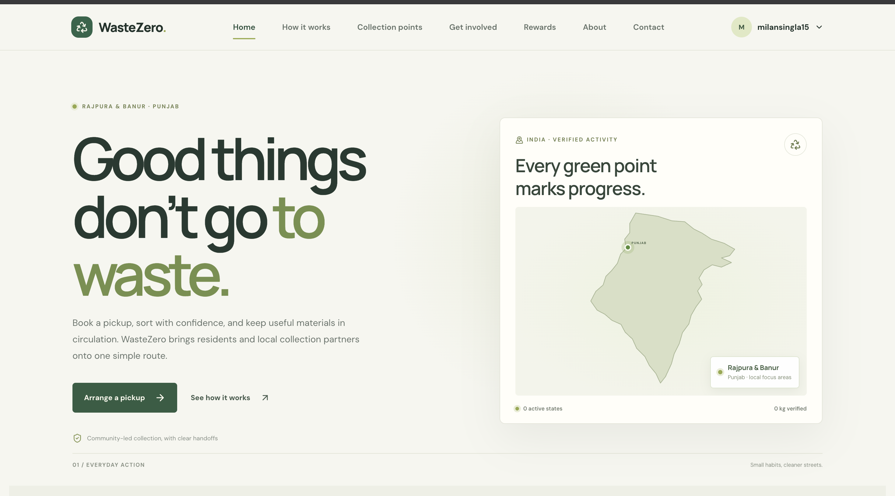

# WasteZero ♻️

<p align="center">
  
  
  
  
  
  
  
  
  
  
  
  
</p>

<p align="center">
  
  
  
  
  
  
</p>


<p align="center">
  <b>Smart Waste Management Platform for Rajpura and Banur, Punjab</b><br>
  <i>Recycle karo, rewards pao, aur city ko saaf rakho!</i>
</p>

## App preview

<p align="center">
  
</p>

---

## Working-copy redesign notes

This separate working copy refreshes the public landing page, shared navigation, global typography, and browser metadata. The homepage hero map marks states with completed recycling pickups; Rajpura and Banur remain highlighted as local focus areas. The Rewards page and homepage leaderboard show the top 10 per area from completed pickup records; each top-10 entry earns an Eco Leader badge and reward eligibility. When a Rewards-area leaderboard has no verified entries, it displays ten prominently labeled fictional demo rows for layout preview only; demo rows do not confer rewards or appear on the homepage. Reward redemption is not currently part of the repository. Pickup CTAs open the authenticated pickup form and preserve that destination through login. Pickup requests offer Rajpura and Banur, Punjab, enter a pending state for admin review, and become scheduled when approved in the admin Pickup Requests queue. Residents receive an in-app approval notification and an email when SMTP is configured. Signed-in users retain the dashboard sidebar while browsing opportunities; the Dashboard entry is part of the role-aware sidebar. The protected user routes now resolve named endpoints before the dynamic user-ID route, and the auth middleware supplies the existing database user's ID, name, role, and suspension state to controllers. Existing authentication flow and database schema are retained. The read-only impact endpoint does not expose addresses, emails, or full account names.

### Setup

Use Node.js and npm. Copy `backend/.env.example` to `backend/.env`, then fill in the MongoDB URI and JWT secret. `EMAIL_SERVICE`, `EMAIL_USER`, and `EMAIL_PASS` configure Gmail OTP login and pickup confirmation emails; use a Google App Password. Keep `.env` private and never add it to the ZIP or source control. `PORT` defaults to `5000`. Set `VITE_API_URL` in `frontend/.env` when the API is not available at `http://localhost:5000`.

For local previews, the login page and signed-in sidebar provide one-click Volunteer, NGO Partner, and Administrator demo access. Set `NODE_ENV=development` and `ENABLE_DEMO_LOGIN=true` in `backend/.env`, and `VITE_ENABLE_DEMO_LOGIN=true` in `frontend/.env`. Demo accounts are created in the configured local database on first use with random, undisclosed passwords. The backend rejects demo login outside development mode; do not expose development mode publicly.

```sh
cd backend
npm install
node server.js
```

In a second terminal:

```sh
cd frontend
npm ci
npm run dev
```

The frontend also provides `npm run build` and `npm run lint`. The backend package currently has no implemented test suite; its `npm test` script intentionally exits with “Error: no test specified”.

### Acknowledgements and dependencies

WasteZero is based on the public work in [vijayshikhare/WasteZero-Smart-Waste-Pickup-Recycling-Platform](https://github.com/vijayshikhare/WasteZero-Smart-Waste-Pickup-Recycling-Platform), created by Batch 13 - 1 and distributed under the MIT License. The original [`LICENSE`](LICENSE) is retained without modification; its copyright and permission notice must accompany copies or substantial portions of the software.

The interface uses the existing React, React Router, Framer Motion, Lucide React, and Tailwind CSS dependencies listed in `frontend/package.json`; backend dependencies remain listed in `backend/package.json`. DM Sans and Manrope are loaded from Google Fonts under their published open font licenses. The new WasteZero favicon is an original SVG created for this working copy. No upstream interface or supplied reference image has been copied pixel-for-pixel.

### Feature prompt for the next implementation pass

> Continue from this WasteZero working copy. Focus the public experience on a top-10 recycling leaderboard with community rewards for Rajpura and Banur, a green-marked India activity map in the homepage hero, reliable pickup scheduling, and a clear way for local organizations to become partners. Remove unrelated demo metrics, fake collection-point listings, and unsupported company claims. Keep the original MIT license and attribution.
>
> Build the leaderboard from completed pickups grouped by area and rank participants by collected kilograms. Build the map from completed pickup records grouped by recognizable Indian state names. Never invent quantities or rankings, and do not expose exact addresses, emails, or full account names in public views. Show a clear empty state until there is verified data. Keep pickup scheduling on the existing authenticated pickup API. Preserve the database schema, authentication, business logic, and upstream notices.
>
> Keep the layout responsive and accessible, verify keyboard navigation and reduced motion, run the existing frontend build/lint and backend test command, and document any checks that cannot pass because of pre-existing issues. Package the working copy as a ZIP while retaining the upstream license file and README provenance.

---

## 📢 About WasteZero

WasteZero is a modern, full-stack, open-source platform designed to improve waste management and recycling. This working copy focuses on Rajpura and Banur, Punjab, while retaining the original application features.

### Why WasteZero?
- **Urban waste is a growing challenge.** WasteZero brings technology, transparency, and community together to solve it.
- **All-in-one platform:** From pickup scheduling to real-time chat, analytics, and rewards, everything is integrated.
- **Open for all:** Anyone can contribute, fork, or deploy their own version for their city.

---

## 🌟 Key Highlights

- **Dynamic, role-based dashboards** for Admin, NGO, Agent, and User
- **Real-time chat** (Socket.io) for instant communication
- **Opportunity matching** for volunteers and NGOs
- **Pickup scheduling** and tracking with notifications
- **Rewards system** to gamify recycling
- **Mobile-first, responsive UI** (Tailwind CSS)
- **Secure authentication** (JWT, role-based)
- **Admin analytics** and reporting
- **Production-ready**: Security, .gitignore, and best practices baked in

---

## 🌐 Live Project

👉 [waste0.vercel.app](https://waste0.vercel.app)

---

## 📊 GitHub Stats

<p align="center">
  

  
</p>

---

## 🏗️ Tech Stack

- **Frontend:** React, Vite, Tailwind CSS
- **Backend:** Node.js, Express, MongoDB
- **Realtime:** Socket.io
- **Deployment:** Vercel (Frontend), Any Node Host (Backend)

---

## 📦 Local Setup

```sh
# 1. Clone the repository
git clone https://github.com/vijayshikhare/WasteZero.git
cd WasteZero

# 2. Install dependencies
cd backend && npm install
cd ../frontend && npm install

# 3. Environment Variables
# Copy `.env.example` to `.env` in both backend/ and frontend/ and fill in your secrets

# 4. Run locally
# Backend:
cd backend && npm start
# Frontend:
cd ../frontend && npm run dev
```

---

## 🖥️ Project Architecture

```
WasteZero/
├── backend/
│   ├── controllers/
│   ├── models/
│   ├── routes/
│   ├── middleware/
│   ├── public/
│   └── server.js
├── frontend/
│   ├── src/
│   │   ├── components/
│   │   ├── pages/
│   │   ├── layouts/
│   │   ├── contexts/
│   │   └── utils/
│   ├── public/
│   └── index.html
├── .env.example
├── .gitignore
└── README.md
```

---

## 🛡️ Security & Best Practices
- All secrets managed via `.env` (never committed)
- Input validation and sanitization on all forms
- File uploads restricted to safe types
- Rate limiting and CORS enabled
- Production-ready `.gitignore` included
- Follows OWASP Top 10 guidelines

---

## 📱 Mobile Friendly
- 100% responsive design
- Sidebar and dashboard adapt to all screen sizes
- Touch-friendly controls and fast loading

---

## 🚀 Usage

1. Register as a user, NGO, or agent
2. Explore dashboard features based on your role
3. Schedule pickups, chat, and earn rewards
4. Admins can view analytics and manage the system

---

## 🧑‍💻 For Developers

- Modular codebase, easy to extend
- Clear separation of frontend and backend
- RESTful API design
- Realtime events via Socket.io
- Custom hooks and context for state management

---

## 🤝 Contributing

> Contributions, stars, and forks are welcome!

1. Fork the repo
2. Create your feature branch (`git checkout -b feature/YourFeature`)
3. Commit your changes (`git commit -m 'Add some feature'`)
4. Push to the branch (`git push origin feature/YourFeature`)
5. Open a Pull Request

---

## ⭐ Show Your Support

- Give a ⭐️ if you like this project!
- Follow [@vijayshikhare](https://github.com/vijayshikhare) for updates
- Share with your network to help us grow
- Add your city as a fork and contribute back!

---

## 📣 Community & Discussions

- [Discussions](https://github.com/vijayshikhare/WasteZero/discussions)
- [Issues](https://github.com/vijayshikhare/WasteZero/issues)
- [Pull Requests](https://github.com/vijayshikhare/WasteZero/pulls)

---

## 📚 FAQ

**Q: Can I use this for my city?**
A: Yes! Fork, customize, and deploy for your city. Contributions welcome.

**Q: Is it free?**
A: 100% open source under MIT license.

**Q: How do I get support?**
A: Open an issue or join the discussions tab.

**Q: How can I contribute?**
A: Fork, create a feature branch, and open a PR. See Contributing section above.

---

## 📄 License
MIT

---

## 🙋‍♂️ Contact & Social

- Email: vijayshikhareteam@gmail.com
- Mobile: +91 9422737898
- [Instagram](https://instagram.com/shikharecoder) | [Twitter](https://twitter.com/vijayshikhre) | [LinkedIn](https://linkedin.com/in/vijayshikhare) | [GitHub](https://github.com/vijayshikhare)

---

<p align="center"><i>WasteZero: Recycle karo, rewards pao, aur city ko saaf rakho!</i></p>

<p align="center">
  
  
  
  
  
</p>

<p align="center">
  <b>Smart Waste Management Platform for Rajpura and Banur, Punjab</b><br>
  <i>Recycle karo, rewards pao, aur city ko saaf rakho!</i>
</p>

---

## 🚀 Features

- 🔑 <b>Role-based dashboards</b> for Admin, NGO, Agent, and User
- 💬 <b>Real-time chat</b> and notifications
- 🤝 <b>Opportunity matching</b> for volunteers and NGOs
- 🚚 <b>Pickup scheduling</b> and tracking
- 🎁 <b>Rewards system</b> for recycling
- 📱 <b>Mobile-friendly, responsive UI</b>
- 🔒 <b>Secure authentication</b> (JWT, role-based access)
- 📊 <b>Admin analytics</b> and reporting

---

## 🌐 Live Project

👉 [waste0.vercel.app](https://waste0.vercel.app)

---

## 🏗️ Tech Stack

- **Frontend:** React, Vite, Tailwind CSS
- **Backend:** Node.js, Express, MongoDB
- **Realtime:** Socket.io
- **Deployment:** Vercel (Frontend), Any Node Host (Backend)

---

## 📦 Local Setup

```sh
# 1. Clone the repository
git clone https://github.com/vijayshikhare/WasteZero.git
cd WasteZero

# 2. Install dependencies
cd backend && npm install
cd ../frontend && npm install

# 3. Environment Variables
# Copy `.env.example` to `.env` in both backend/ and frontend/ and fill in your secrets

# 4. Run locally
# Backend:
cd backend && npm start
# Frontend:
cd ../frontend && npm run dev
```

---

## 🛡️ Security & Best Practices
- All secrets managed via `.env` (never committed)
- Input validation and sanitization on all forms
- File uploads restricted to safe types
- Rate limiting and CORS enabled
- Production-ready `.gitignore` included

---

## 📱 Mobile Friendly
- 100% responsive design
- Sidebar and dashboard adapt to all screen sizes

---

## 🤝 Contributing

> Contributions, stars, and forks are welcome!

1. Fork the repo
2. Create your feature branch (`git checkout -b feature/YourFeature`)
3. Commit your changes (`git commit -m 'Add some feature'`)
4. Push to the branch (`git push origin feature/YourFeature`)
5. Open a Pull Request

---

## ⭐ Show Your Support

- Give a ⭐️ if you like this project!
- Follow [@vijayshikhare](https://github.com/vijayshikhare) for updates
- Share with your network to help us grow

---

## 📄 License
MIT

---

## 🙋‍♂️ Contact & Social

- Email: vijayshikhareteam@gmail.com
- Mobile: +91 9422737898
- [Instagram](https://instagram.com/shikharecoder) | [Twitter](https://twitter.com/vijayshikhre) | [LinkedIn](https://linkedin.com/in/vijayshikhare) | [GitHub](https://github.com/vijayshikhare)

---

<p align="center"><i>WasteZero: Recycle karo, rewards pao, aur city ko saaf rakho!</i></p>
